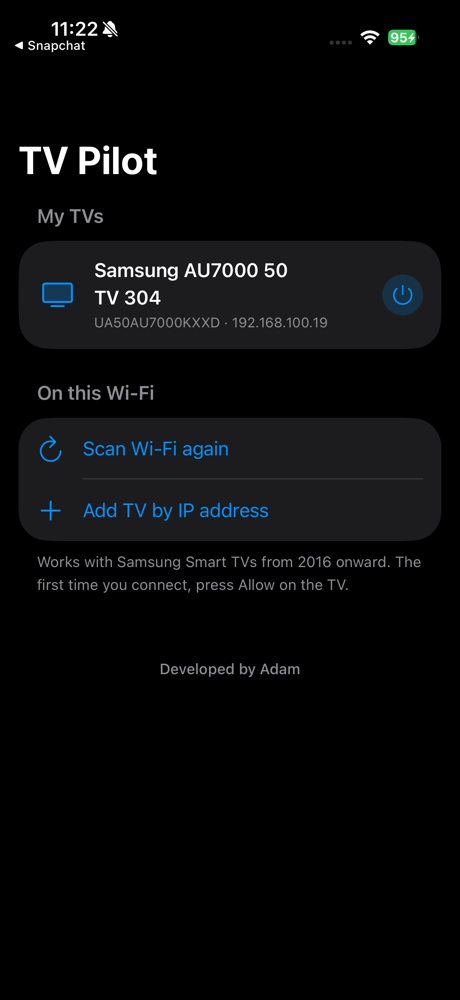
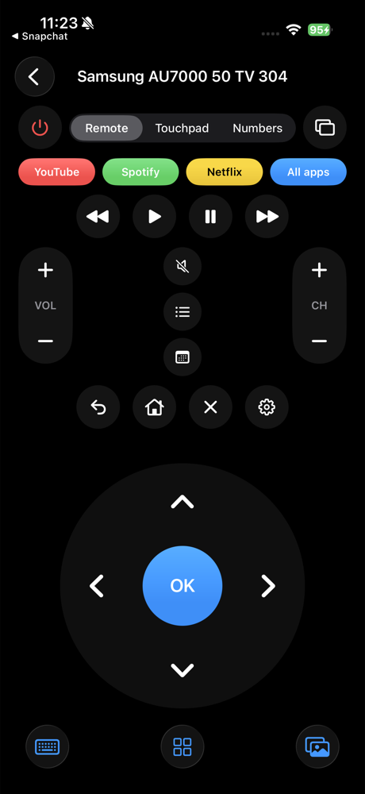
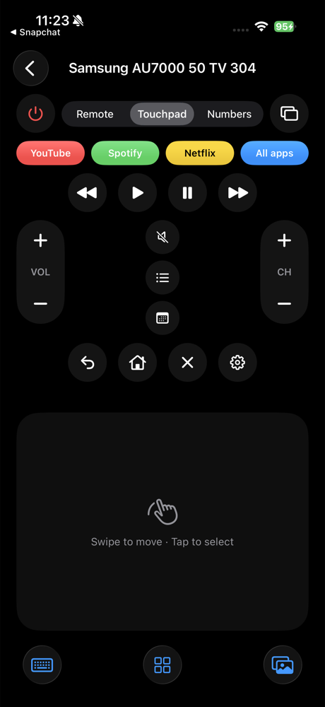
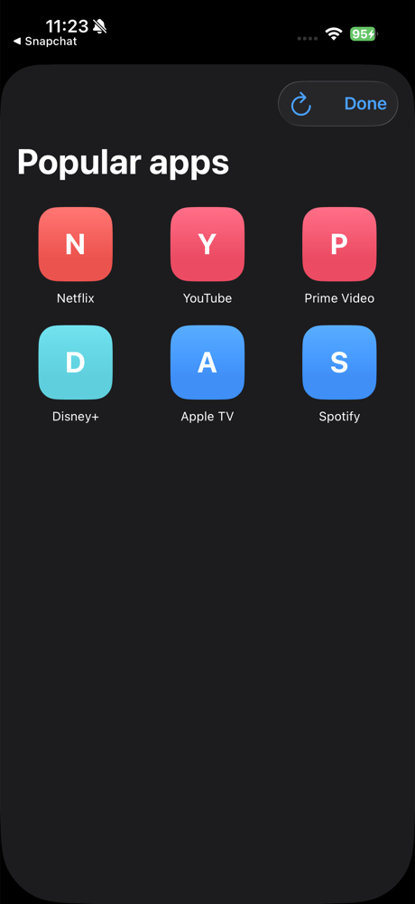
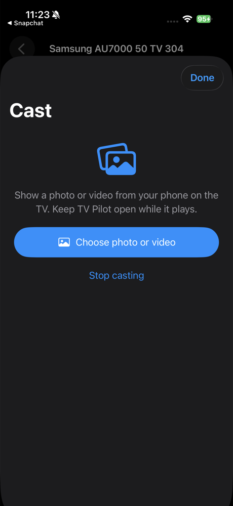

# TV Pilot

An iPhone remote for Samsung Smart TVs (2016 and newer), over Wi-Fi.

<p>
  
  
  
  
  
</p>

## Features

- Finds TVs on your Wi-Fi automatically, or add one by IP address
- Saves several TVs and turns them on with Wake-on-LAN
- Full remote: arrows and OK, touchpad, number pad, volume, channels, media keys
- App shortcuts (YouTube, Spotify, Netflix) and a list of every app on the TV, with their real logos
- Keyboard: type from your phone into the TV's search boxes
- Cast photos and videos from your phone to the TV

## Build

Requires Xcode and [XcodeGen](https://github.com/yonaskolb/XcodeGen).

```sh
xcodegen generate
open TVPilot.xcodeproj
```

Pick your own team under Signing & Capabilities, then run it on your iPhone.

Developed by Adam.
